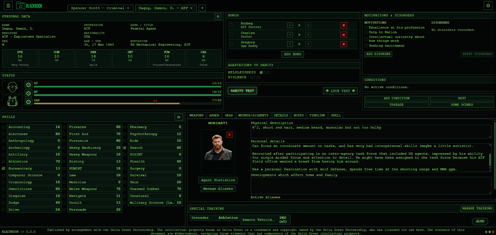
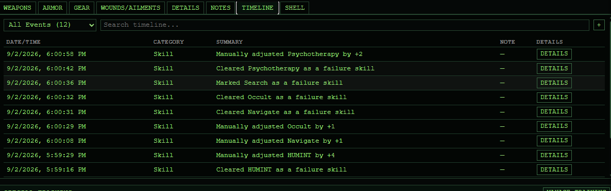
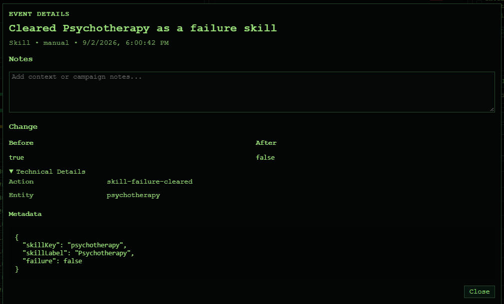
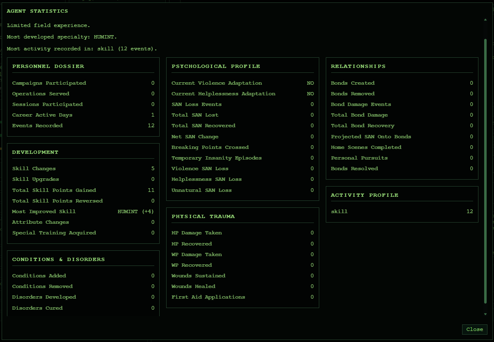
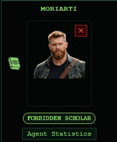
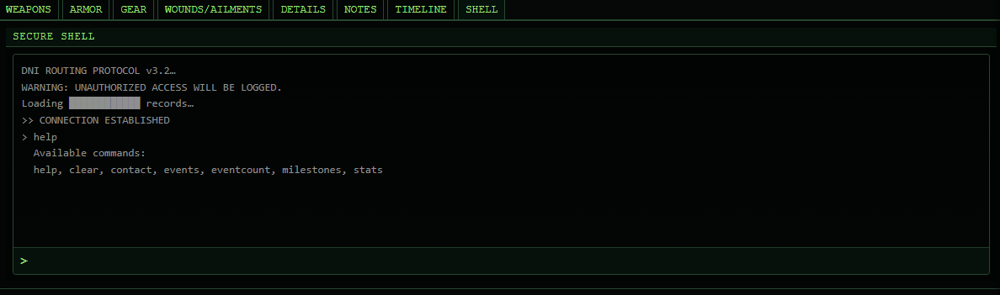

# Blackbook


> **Project Status**  
> Blackbook is a hobby project built and maintained in spare time. While development is ongoing, features, priorities, and pace may change without notice. There are no promised timelines or guarantees.

**Blackbook** is a browser‑based agent dossier and campaign management tool for the *Delta Green* role‑playing game.  
It is designed to feel like an in‑universe terminal while remaining fast, private, and fully client‑side.

All data lives in your browser. No accounts. No backend.

---

## Live Version

The latest deployed version is available via **GitHub Pages**:

 **https://blackbook-rpg.app/**

**Current Version:** v0.3.1

## Screenshots

| Player Panel | Timeline | Event Details |
|---------------|----------|---------------|
| [](docs/images/player-panel-with-details.png) | [](docs/images/timeline.png) | [](docs/images/event-details.png) |

| Statistics | Milestones | Terminal |
|------------|------------|----------|
| [](docs/images/statistics.png) | [](docs/images/milestones.png) | [](docs/images/terminal.png) |

---

## Core Principles

- Offline-first
- Local-first data ownership
- No required accounts
- No backend services
- Mobile-friendly
- Fully portable JSON data
- Browser-native persistence
- Designed to support long-running campaigns
- Agent event driven histories  
  
---

## Features

### Agent Management

- Full agent creation and editing
- Profession management
- Attributes and statistics tracking
- HP, WP, SAN, and Breaking Point tracking
- Bonds and motivations
- Disorders and sanity adaptations
- Aliases and personal details
- Character photo support
- Notes and record keeping
  
#### Agent History & Timeline
- Persistent event history
- Searchable timeline
- Timeline filtering
- Event inspection
- Event comments
- Session markers
- Operation markers
- Campaign markers
- Mobile timeline experience

#### Statistics & Milestones
- Event-driven statistics engine
- Career analysis
- Most improved skills
- Agent milestone tracking
- Achievement-style milestone badges
- Terminal statistics commands
- Terminal milestone commands

### Skills & Advancement

- Complete skill tracking
- Skill advancement
- Special training 
- Personal pursuits
- Home scene support
  
### Operational Tracking

- Weapons management
- Armor management
- Gear inventory
- Conditions tracking
- Wound and ailment tracking
- Recovery and rest tracking
  
### Play Mode

- Dedicated Play Mode
- Session-focused stat adjustments
- Dice rolling
- Roll history
- Lethality support
- Reduced bookkeeping during play

#### Terminal Interface
- In-universe terminal experience
- Terminal commands
- Statistics command
- Milestones command
- Hidden easter eggs

### Data Ownership

- Browser-based persistence
- Works completely offline
- JSON import/export
- Fully portable agent records
  
### Event-Driven Architecture

Blackbook uses an event-driven architecture where the current Agent state remains authoritative while a persistent event history records how that state evolved.

This allows Blackbook to provide:

- Timeline browsing
- Historical analysis
- Agent statistics
- Career milestones
- Session and campaign markers
- Future synchronization and campaign features

The event system serves as the foundation for Blackbook's long-term roadmap.  

---

## Importing & Exporting Agents

*   **Export**: Use the header menu → *Export Agent*
*   **Import**: Use *Import Agent* to load a previously saved `.json` file

All files are plain JSON and fully portable.

---

## Running Locally

If you already have a built version of the app, you **do not need Node.js or npm** to run it locally.  
You only need a simple static file server.

### Using Python (Recommended)

From the project root (where the `build/` folder exists):

#### Python 3

```bash
mkdir -p local/blackbook
cp -r build/* local/blackbook/
cd local/blackbook
python -m http.server 8080
````

Then open your browser to:

    http://localhost:8080/

#### Python 2 (legacy)

```bash
mkdir -p local/blackbook
cp -r build/* local/blackbook/
cd local
python -m SimpleHTTPServer 8080
```

#### Windows Note
If `cp` is not recognized use:  
  
```bat
xcopy build\* local\blackbook\ /E /I
```

#### Troubleshooting  
If the page is blank, make sure the URL ends with `/blackbook/`.

>That’s it.  
>No tooling, no dependencies, no dev server.

---

## Building the App

You only need this if `build/` does **not** exist yet.

```bash
npm install
npm run build
```

This generates the `build/` directory used by both GitHub Pages and the Python server above.

Once built, you can stop using npm entirely.

---

## Development

If you want live reload and development tooling:

```bash
npm install
npm start
```

This runs the app at:

    http://localhost:3000/blackbook/

---

## Project Structure (High‑Level)

    public/     Static HTML and assets
    src/        React + TypeScript source
    build/      Production build output (static files)

The app is a **pure static site** once built.

---

## Roadmap

The roadmap reflects current direction and priorities rather than guaranteed deliverables.

### ✅ v0.1 — Core Agent Management

- Agent dossiers
- Skills and professions
- Inventory systems
- Derived statistics
- Offline storage
- Import/export

**Status:** Complete

---

### ✅ v0.2 — Event Architecture

- Persistent agent event system
- Comprehensive event coverage
- Audit history foundation
- Future synchronization support
- Timeline groundwork

**Status:** Complete

---

#### ✅ v0.3 — Agent History
  
- Timeline system
- Event inspection
- Event comments
- Search and filtering
- Session, operation, and campaign markers
- Statistics engine
- Milestones
- Mobile timeline experience

**Status:** Complete

---

#### 🚧 v0.4 — PWA Foundation

Current focus:
- PWA installation support
- Application updates
- Enhanced offline capabilities
- Mobile-first improvements
- Device integration groundwork
- Foundation for future synchronization

**Status:** In Progress

---

### 🔒 v0.5 — Campaign Framework

Planned focus:

- Case management
- Operations tracking
- Shared campaign records
- Investigation support tools

---

### 🔒 v0.6 — Handler Mode Alpha

Planned focus:

- Handler oversight tools
- Agent monitoring
- Event-driven campaign support

---

### 🔒 v0.7 — Agent Connections

Planned focus:

- Relationship tracking
- Bond visualization
- Agent network features

---

### 🔒 v0.8 — WebRTC Live Sync

Planned focus:

- Peer-to-peer synchronization
- No mandatory server infrastructure
- Local-first multiplayer support

---

### 🔒 v0.9 — Campaign Operations

Planned focus:

- Large campaign support
- Stress testing
- Advanced campaign tooling

---

### 🎯 v1.0 — Blackbook Platform

Target vision:

A complete offline-first Delta Green campaign platform supporting agents, operations, investigations, campaign history, handler workflows, and long-running interconnected campaigns while preserving complete user ownership of data.

Blackbook's long-term goal is to provide the depth of a campaign management suite without sacrificing portability, privacy, or offline usability.

---

> The project prioritizes **gameplay value, offline usability, and long‑term maintainability** over rapid feature expansion.

---

## License & Attribution

Published by arrangement with the Delta Green Partnership. The intellectual property known as Delta Green is a trademark and copyright owned by the Delta Green Partnership, who has licensed its use here. The contents of this document are ©Imbeinabout, excepting those elements that are components of the Delta Green intellectual property.

---

## Contributing

Issues and pull requests are welcome. Feel free to open an issue to request new features.

If you plan significant changes, please open an issue first to discuss scope and direction.

---

> **BLACKBOOK**
>
> Trust no one. Keep your records clean.
>  

